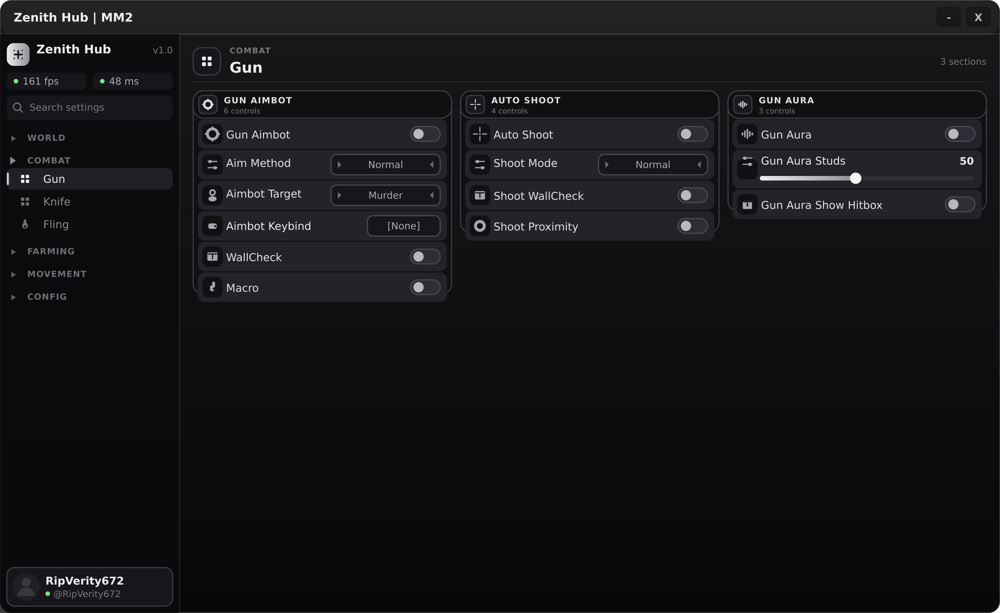
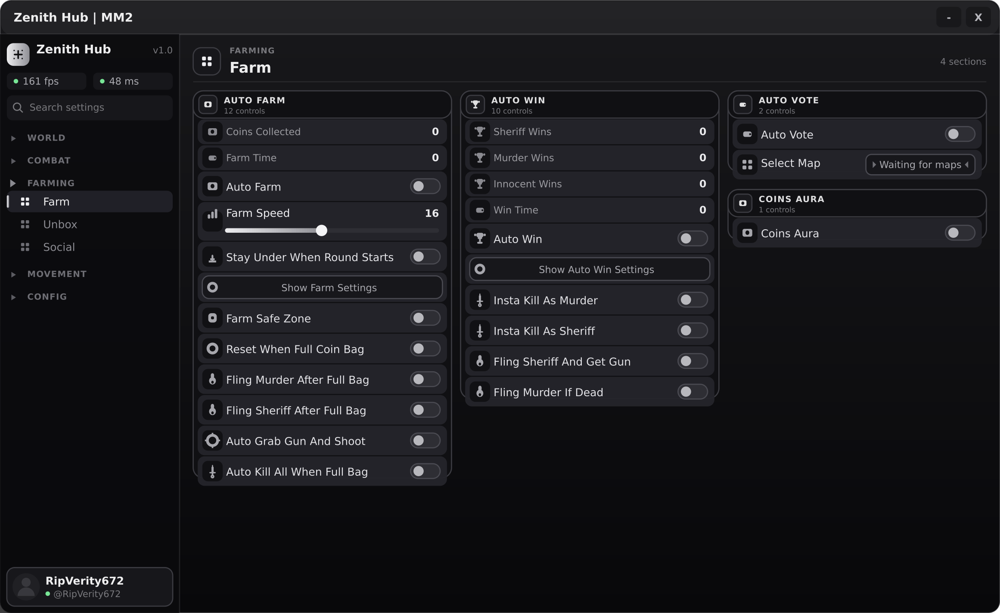
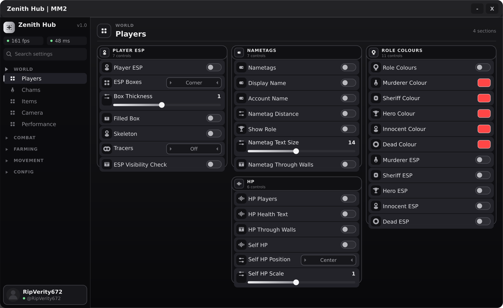
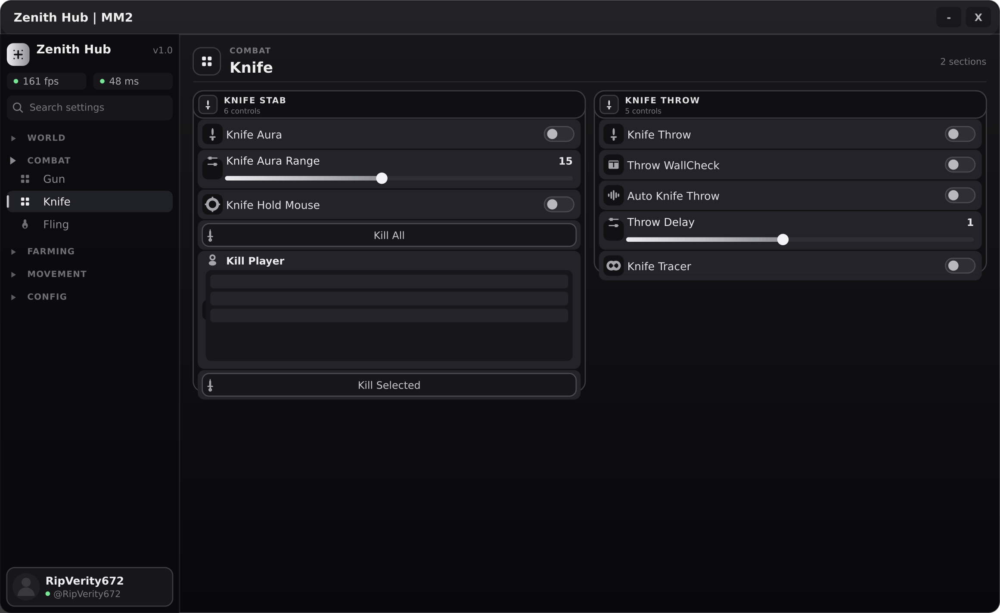
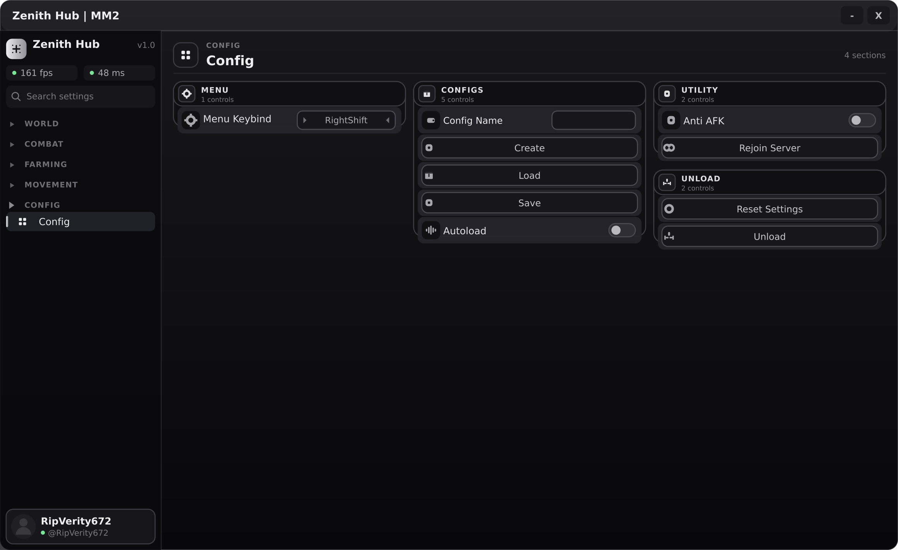
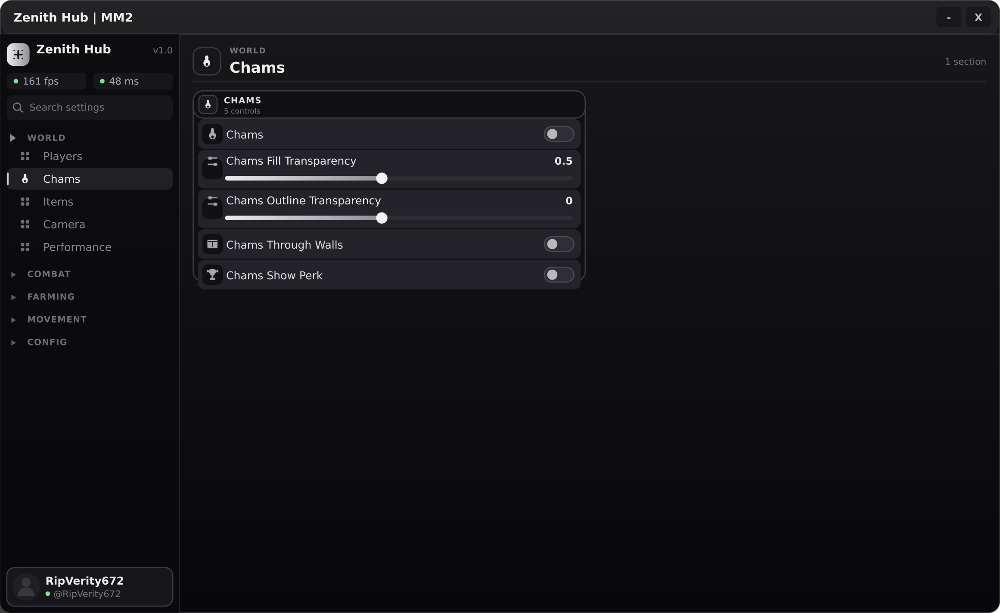

# Zenith Hub — horizontal layout

`ZenithHub-Horizontal.lua` is the MM2-hub / Zenith script rebuilt as a **compact
horizontal** window: a narrow left rail plus a three-column content grid, in the
Star Hub style (grouped sub-tabs, pill switches, inline cycle chips, footer player
card) while keeping Zenith's monochrome look — grey gradients, SourceSans, spark mark.

Every control carries a **monochrome icon**, section headers lead with an icon chip
and a live control count, the whole grid is centred on a max width, and each panel
lists its strongest module first instead of its declaration order.

Everything below the UI is untouched: the same 40 sections and 204 controls, the same
setters, config files, keybinds, and the full prediction/anti-cheat code are carried
over verbatim (only re-parented into per-tab pages).

## Icons

`ICONS` holds 29 glyphs built from small solid `Frame`s plus inset cut-outs (`a`/`b`
are relative anchors, `w`/`h` are pixels at 1×), so there are no image assets and no
textures to load. `MODULE_ICONS` maps every control (208 entries) and `SECTION_ICONS`
maps every panel to a glyph — target, crosshair, pulse, knife, flame, shield, sword,
cash, trophy, bulb, gear, wind, chip… All share one monochrome tint (`ICON_COLOR`),
brightening to `ACCENT_A` when a toggle is on or a tab is selected.

## Layout

```
┌─────────────────────────────────────────────────────────┐
│ Zenith Hub | MM2                                  -  X │
├──────────┬──────────────────────────────────────────────┤
│ ✦ Zenith │  ⊙  COMBAT                     3 sections    │
│ ●161 ●48 │  ◆ Gun                                       │
│ [search] ├─────────────┬─────────────┬─────────────────┤
│ ▸ WORLD  │ ◎ GUN AIMBOT│ ✛ AUTO SHOOT│ ∿ GUN AURA      │
│ ▾ COMBAT │   6 controls│   4 controls│    3 controls   │
│   ⊙ Gun  │ ◎ Gun Aimbot│ ✛ Auto Shoot│ ∿ Gun Aura    ● │
│   ⚔ Knife│ ≡ Aim Method│ ≡ Shoot Mode│ ≡ Gun Aura Studs│
│   ♨ Fling│      Normal │    Normal   │ ▬▬▬▬▬●───── 50  │
│ ▸ FARMING│ ...         │ ...         │ ...             │
│ [player] │             │             │                 │
└──────────┴─────────────┴─────────────┴─────────────────┘
```

* Window **880×540** (resizable 760–1280 × 400–760), 158 px rail, 30 px title bar.
* Content is centred on a **900 px max width** with a 12 px inset, so rows never
  stretch into long empty bars on a wide window; three equal columns share the width
  by scale and follow a resize.
* Page header is 34 px: 22 px icon chip for the tab, uppercase group caption, 14.5 px
  title, right-aligned `N sections` counter and a hairline rule.
* Control rows are 24 px high with their icon on a recessed 18 px chip; a section
  panel is a quiet card whose header is a 16 px icon chip, the uppercase title and a
  live `N controls` subtitle.
* Sections stay in their written columns (left to right). Tabs that hold fewer
  sections than they declare hide the empty columns and share the width between the
  ones in use, so a two-panel page still fills the pane.
* Rows inside a panel are ordered by importance (`MODULE_PRIORITY`): Gun Aimbot, Auto
  Shoot, Knife Aura, Auto Knife Throw, Auto Win, Auto Farm, Player ESP, Chams, Auto
  Unbox, Anti Fling, Enable Fly, Enable Speed… Diagnostics such as *Coins Collected*,
  *Farm Time* or the *Wins* counters sink to the bottom. Only the layout moves —
  names, keys, defaults and section membership are untouched.

## Tabs

| Group | Tabs | Sections |
|-------|------|----------|
| World | Players · Chams · Items · Camera · Performance | ESP, nametags, HP, roles, chams, item/coin ESP, X-Ray, fullbright, FOV, zoom, FreeCam, FPS options |
| Combat | Gun · Knife · Fling | Gun Aimbot, Auto Shoot, Gun Aura, Knife Stab, Knife Throw, Fling, Anti Fling |
| Farming | Farm · Unbox · Social | Auto Farm, Auto Win, Auto Vote, Coins Aura, Auto Unbox, Emotes, Disguise, Blurt Roles |
| Movement | Fly · Speed · Jump · Warp | Fly, Speed, Sprint Tail, Jump, Infinite Jump, Gravity, Teleport, Movement Toggles |
| Config | Config | Menu keybind, config files, Utility, Unload |

## Behaviour changes (UI only)

* **Rail** — brand mark, fps/ping pills refreshed once per second, search box,
  five collapsible groups, and a player card with live thumbnail. **Only the active
  group stays expanded** (opening a sub-tab folds the others), and the list scrolls
  as a fallback, so the rail always fits a short window.
* **Search** — still filters control names, and now jumps to the first sub-tab that
  contains a match (necessary when 16 tabs are in play); matching also covers the
  module's icon name.
* **Defaults** — the hub opens on **Gun** (whose group is the one expanded in the
  rail) instead of Main, since Main no longer exists as a page.
* **Minimise / resize / close** — all still work; the rail and grid reflow with the
  window.
* Removed the old top tab bar, its sliding indicator, the two-column page layout, and
  the ripple animation on every row (it repainted the whole row on each press).

## Previews

Rendered from the generated script's own `addSection` / `add*` call order, with the
same card heights and the same icon primitives the Lua builds:

| Gun | Farm |
|---|---|
|  |  |

| Players | Knife | Config |
|---|---|---|
|  |  |  |



## Verification

* Compiles with the real Luau compiler (`luau-rs` 0.739) and parses with StyLua
  (`--syntax Luau`).
* Widget mapping vs. the reference: `TextButton` rows + pill switch = toggle,
  inline chip with chevrons = cycle, 4 px track + 10 px knob = slider,
  quiet bordered row = button, section card = panel with a 24 px icon header.
* Parity after the restyle: **40 sections** and **204 controls**, identical names, and
  no duplicate `local function` definitions.
* Section parity vs. the source script: 40/40 sections, 204/204 controls, no
  duplicate local declarations.
* Original files are preserved: `README.md` (the Byte system prompt) is untouched.

## Usage

```lua
loadstring(game:HttpGet("<raw url of ZenithHub-Horizontal.lua>"))()
```

MM2-only sections stay hidden outside `PlaceId 142823291`, exactly as before.
