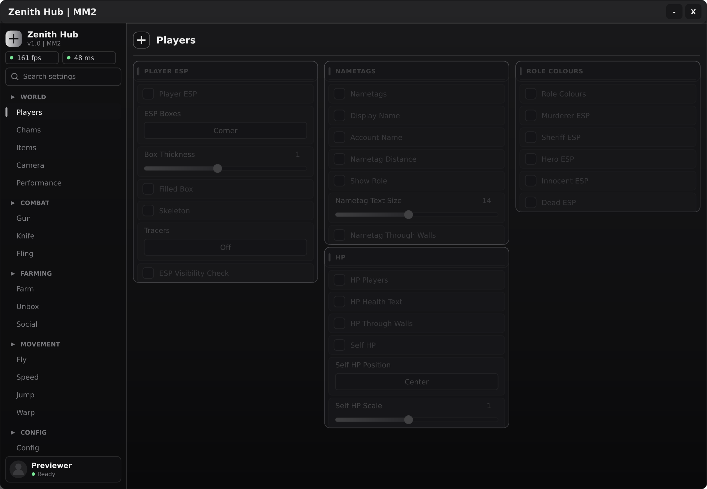
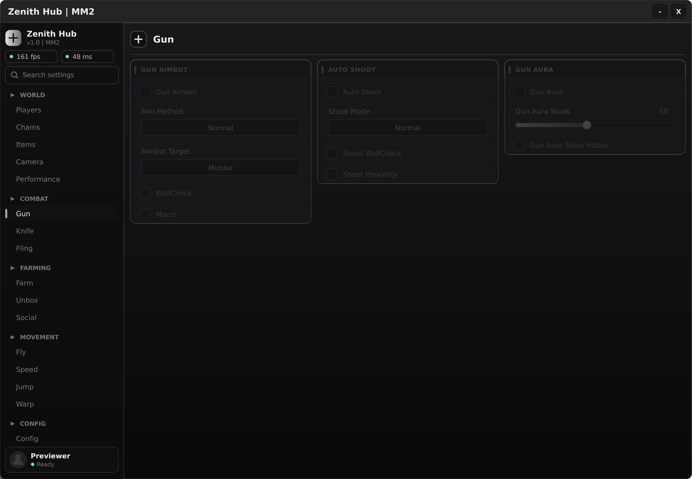
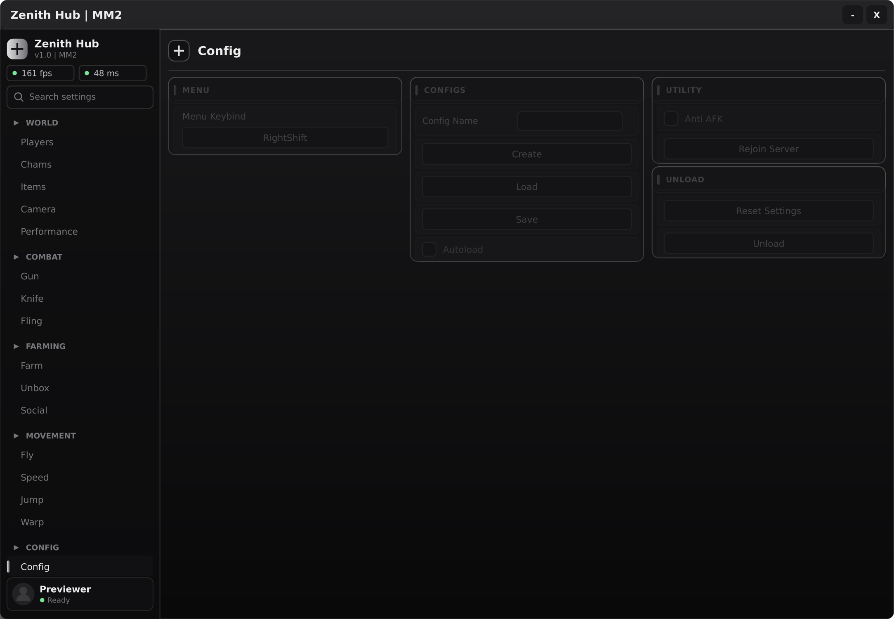

# Zenith Hub — horizontal layout

`ZenithHub-Horizontal.lua` is the MM2-hub / Zenith script rebuilt as a **horizontal**
window: a left navigation rail plus a three-column content grid, styled after the
Star Hub reference (grouped sub-tabs, live fps/ping pills, player card) instead of the
original vertical 400×600 window with four top tabs and two scrolling columns.

Everything below the UI is untouched: the same 40 sections and 204 controls, the same
setters, config files, keybinds, and the full prediction/anti-cheat code are carried
over verbatim (only re-parented into per-tab pages).

## Layout

```
┌──────────────────────────────────────────────────────────────┐
│ Zenith Hub | MM2                                       -   X │
├────────────┬─────────────────────────────────────────────────┤
│ ✦ Zenith   │  ✦  Gun                                         │
│   v1.0|MM2 ├──────────────┬──────────────┬───────────────────┤
│ ● 161 fps  │ GUN AIMBOT   │ AUTO SHOOT   │ GUN AURA          │
│ ● 48 ms    │              │              │                   │
│ [search]   │              │              │                   │
│ ▾ WORLD    │              │              │                   │
│   Players  │              │              │                   │
│ ▾ COMBAT   │              │              │                   │
│   Gun      │              │              │                   │
│ ▾ …        │              │              │                   │
│ [player]   │              │              │                   │
└────────────┴──────────────┴──────────────┴───────────────────┘
```

* Window **1040×720** (resizable 900–1520 × 500–960), 186 px rail.
* Three equal columns sharing width by scale, so the grid follows a resize.
* Sections split into contiguous, height-balanced columns (they still read left to
  right); tabs with fewer than three sections keep the same column width.

## Tabs

| Group | Tabs | Sections |
|-------|------|----------|
| World | Players · Chams · Items · Camera · Performance | ESP, nametags, HP, roles, chams, item/coin ESP, X-Ray, fullbright, FOV, zoom, FreeCam, FPS options |
| Combat | Gun · Knife · Fling | Gun Aimbot, Auto Shoot, Gun Aura, Knife Stab, Knife Throw, Fling, Anti Fling |
| Farming | Farm · Unbox · Social | Auto Farm, Auto Win, Auto Vote, Coins Aura, Auto Unbox, Emotes, Disguise, Blurt Roles |
| Movement | Fly · Speed · Jump · Warp | Fly, Speed, Sprint Tail, Jump, Infinite Jump, Gravity, Teleport, Movement Toggles |
| Config | Config | Menu keybind, config files, Utility, Unload |

## Behaviour changes (UI only)

* **Rail** — brand mark, fps/ping pills refreshed once per second, search box,
  collapsible groups, and a player card with the live thumbnail. Groups can be
  collapsed; opening a sub-tab expands its group automatically.
* **Search** — still filters control names, and now also jumps to the first sub-tab
  that contains a match (necessary when 16 tabs are in play).
* **Defaults** — the hub opens on **Gun** instead of Main, since Main no longer
  exists as a page.
* **Minimise / resize / close** — all still work; the rail and grid reflow with the
  window.
* Removed the old top tab bar, its sliding indicator, and the two-column page layout.

## Previews

Rendered from the generated script's own `addSection` / `add*` call order, using the
same card heights the Lua uses:

| Players (3 columns) | Gun (3 columns) | Config (3 columns) |
|---|---|---|
|  |  |  |

## Verification

* Compiles with the real Luau compiler (`luau-rs` 0.739) and parses with StyLua
  (`--syntax Luau`).
* Section parity vs. the source script: 40/40 sections, 204/204 controls, no
  duplicate local declarations.
* Original files are preserved: `README.md` (the Byte system prompt) is untouched.

## Usage

```lua
loadstring(game:HttpGet("<raw url of ZenithHub-Horizontal.lua>"))()
```

MM2-only sections stay hidden outside `PlaceId 142823291`, exactly as before.
