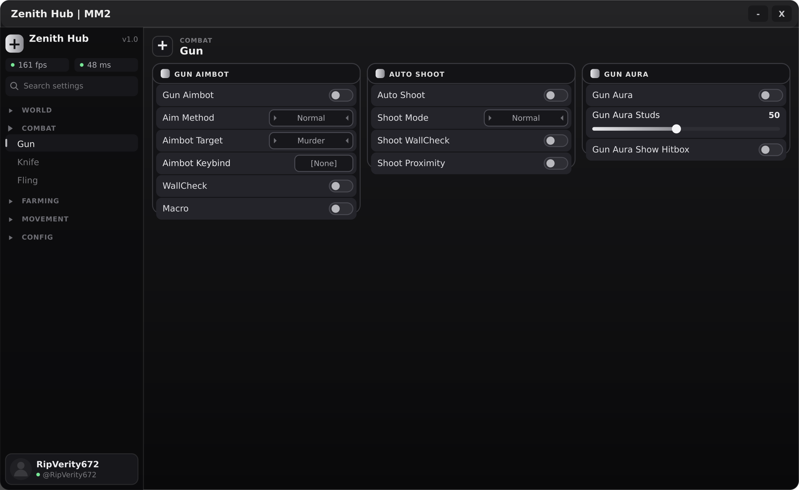
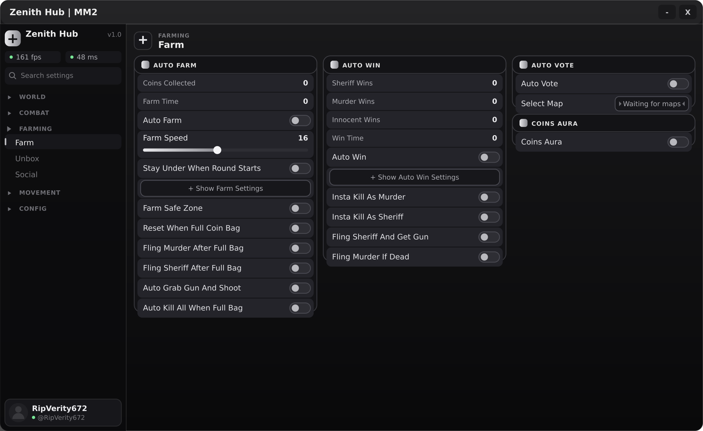
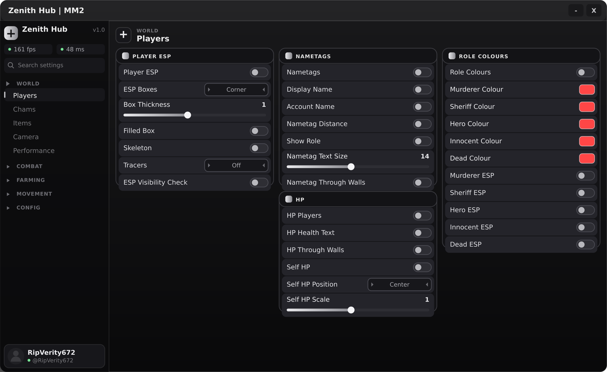
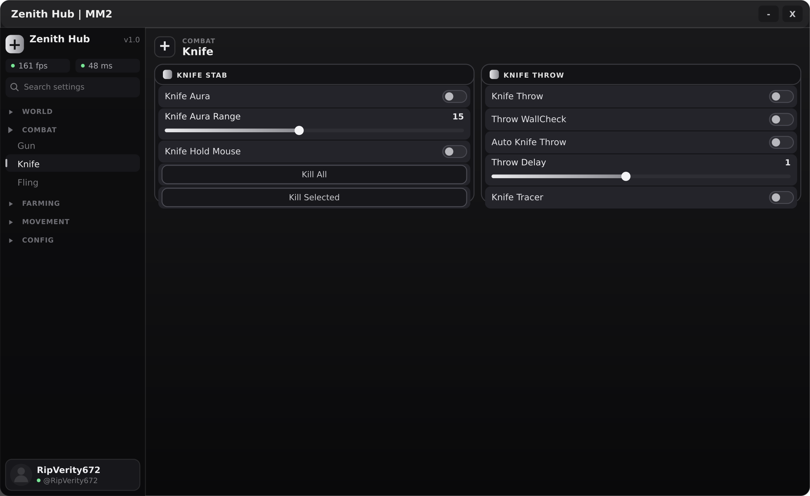
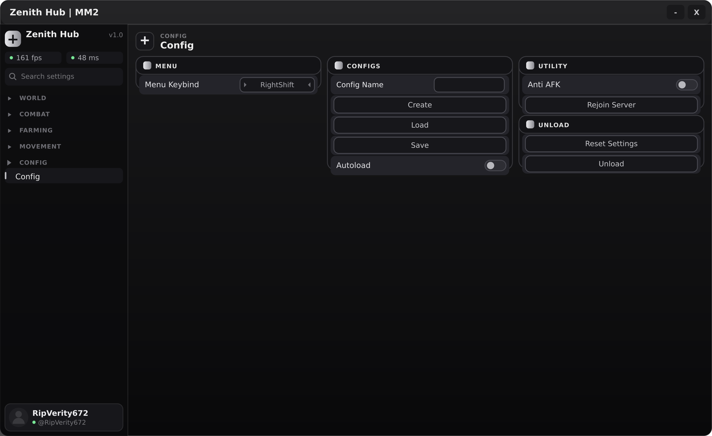

# Zenith Hub — horizontal layout

`ZenithHub-Horizontal.lua` is the MM2-hub / Zenith script rebuilt as a **compact
horizontal** window: a narrow left rail plus a three-column content grid, in the
Star Hub style (grouped sub-tabs, pill switches, inline cycle chips, footer player
card) while keeping Zenith's monochrome look — grey gradients, SourceSans, spark mark.

Everything below the UI is untouched: the same 40 sections and 204 controls, the same
setters, config files, keybinds, and the full prediction/anti-cheat code are carried
over verbatim (only re-parented into per-tab pages).

## Layout

```
┌─────────────────────────────────────────────────────────┐
│ Zenith Hub | MM2                                  -  X │
├──────────┬──────────────────────────────────────────────┤
│ ✦ Zenith │  ✦  COMBAT                                   │
│ ●161 ●48 │  ◆ Gun                                       │
│ [search] ├─────────────┬─────────────┬─────────────────┤
│ ▸ WORLD  │ ◆ GUN AIMBOT│ ◆ AUTO SHOOT│ ◆ GUN AURA      │
│ ▾ COMBAT │ Gun Aimbot ●│ Auto Shoot ●│ Gun Aura      ● │
│   Gun    │ Aim Method  │ Shoot WallCk│ Gun Aura Studs  │
│   Knife  │      Normal │    Normal   │ ▬▬▬▬▬●───── 50  │
│ ▸ FARMING│ ...         │ ...         │ ...             │
│ [player] │             │             │                 │
└──────────┴─────────────┴─────────────┴─────────────────┘
```

* Window **880×540** (resizable 760–1280 × 400–760), 158 px rail, 30 px title bar.
* Three equal columns share width by scale, so the grid follows a resize.
* Control rows are 24 px high; a section panel is a quiet card with a 22 px header.
* Sections split into contiguous, height-balanced columns (they still read left to
  right); tabs with fewer than three sections keep the same column width.

## Tabs

| Group | Tabs | Sections |
|-------|------|----------|
| World | Players · Chams · Items · Camera · Performance | ESP, nametags, HP, roles, chams, item/coin ESP, X-Ray, fullbright, FOV, zoom, FreeCam, FPS options |
| Combat | Gun · Knife · Fling | Gun Aimbot, Auto Shoot, Gun Aura, Knife Stab, Knife Throw, Fling, Anti Fling |
| Farming | Farm · Unbox · Social | Auto Farm, Auto Win, Auto Vote, Coins Aura, Auto Unbox, Emotes, Disguise, Blurt Roles |
| Movement | Fly · Speed · Jump · Warp | Fly, Speed, Sprint Tail, Jump, Infinite Jump, Gravity, Teleport, Movement Toggles |
| Config | Config | Menu keybind, config files, Utility, Unload |

## Behaviour changes (UI only)

* **Rail** — brand mark, fps/ping pills refreshed once per second, search box,
  five collapsible groups, and a player card with live thumbnail. **Only the active
  group stays expanded** (opening a sub-tab folds the others), and the list scrolls
  as a fallback, so the rail always fits a short window.
* **Search** — still filters control names, and now also jumps to the first sub-tab
  that contains a match (necessary when 16 tabs are in play).
* **Defaults** — the hub opens on **Gun** (whose group is the one expanded in the
  rail) instead of Main, since Main no longer exists as a page.
* **Minimise / resize / close** — all still work; the rail and grid reflow with the
  window.
* Removed the old top tab bar, its sliding indicator, the two-column page layout, and
  the ripple animation on every row (it repainted the whole row on each press).

## Previews

Rendered from the generated script's own `addSection` / `add*` call order, using the
same card heights the Lua uses:

| Gun | Farm |
|---|---|
|  |  |

| Players | Knife | Config |
|---|---|---|
|  |  |  |

## Verification

* Compiles with the real Luau compiler (`luau-rs` 0.739) and parses with StyLua
  (`--syntax Luau`).
* Widget mapping vs. the reference: `TextButton` rows + pill switch = toggle,
  inline chip with chevrons = cycle, 4 px track + 10 px knob = slider,
  quiet bordered row = button, section card = panel with 22 px header.
* Section parity vs. the source script: 40/40 sections, 204/204 controls, no
  duplicate local declarations.
* Original files are preserved: `README.md` (the Byte system prompt) is untouched.

## Usage

```lua
loadstring(game:HttpGet("<raw url of ZenithHub-Horizontal.lua>"))()
```

MM2-only sections stay hidden outside `PlaceId 142823291`, exactly as before.
